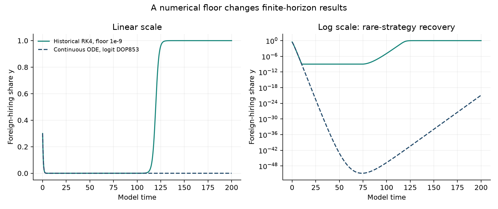
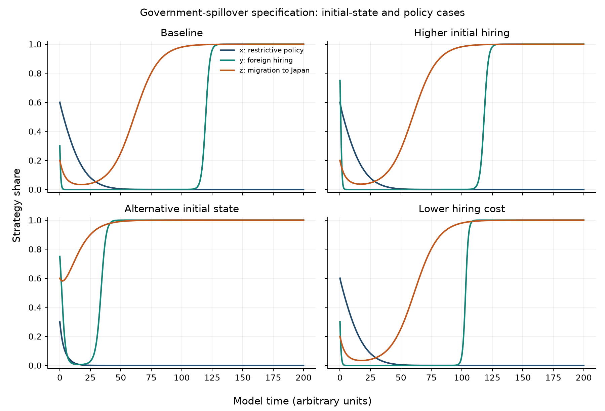
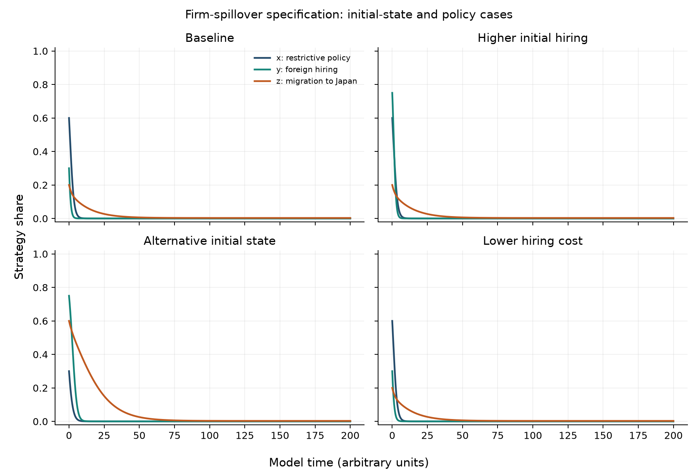
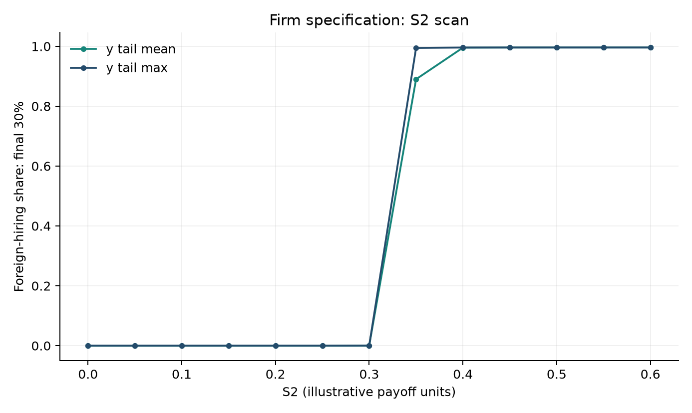

# Evolutionary Game Modeling of Immigration Policy

**Kai Zhang · Undergraduate thesis project · English technical companion**

A three-population evolutionary game of government immigration policy, firms' foreign-hiring choices and talent migration to Japan. This repository presents the model equations, payoff differences, analytic Jacobians, local-stability conditions and reproducible English simulations reconstructed from the supplied thesis scripts.

**Start here:** [Mathematical notes](docs/MODEL.md) · [English PDF](docs/English_Model_Notes.pdf) · [Source provenance](docs/PROVENANCE.md) · [Validation results](results/validation.json)

## What the project demonstrates

- Replicator dynamics for three interacting two-strategy populations.
- Expected payoffs, equilibrium conditions and Jacobian eigenvalue analysis.
- RK4/Euler reproduction, parameter scans and initial-condition comparisons.
- Independent SciPy integration and careful separation of numerical regularization from the underlying ODE.

There are **two specifications**, not one interchangeable model:

| Specification | Spillover mechanism | Dynamics | Historical integrator |
|---|---|---|---|
| A: government benefits | $R_1yz+R_2z$ in expansion-policy payoffs | Replicator, no explicit mutation | Clipped RK4 |
| B: firm hiring costs | $C_3^{eff}=\max(C_3-\eta z,0)$ | Replicator plus $\mu_i(1/2-q_i)$ | Clipped Euler |

The state is $x=$ restrictive-policy share, $y=$ foreign-hiring share, $z=$ migration-to-Japan share. **Expansion corresponds to $x=0$.** All parameters are illustrative; the repository does not estimate causal policy effects.

## A numerical finding worth reading first

Reproducing an original table is not the same as verifying that its numerical procedure accurately solves the unmodified ODE. In the government model, the original $10^{-9}$ population floor materially changes the finite-horizon recovery of a rare hiring strategy.

For the same baseline at $T=200$, the original clipped scheme gives $y\approx1$, while a positivity-preserving logit-coordinate SciPy reference gives $y\approx1.22\times10^{-21}$. This is explained and tested, rather than hidden behind a policy-convergence claim.



## Mathematics

For Model A, define $A=(E_2-C_2)-(E_1-C_1)$ and $d=E_5-C_5-E_6$. Then

$$
\begin{aligned}
\dot x&=x(1-x)[A+(S_1-R_1)yz+(S_2-R_2)z],\\
\dot y&=y(1-y)[-C_3-E_4+C_4+z(E_3+(1-x)S_1)],\\
\dot z&=z(1-z)[d+(1-x)S_2].
\end{aligned}
$$

At $(x,y,z)=(0,1,1)$, the baseline Jacobian eigenvalues are $(-0.7,-0.6,-0.1)$. This establishes **local** asymptotic stability, not a guaranteed finite-horizon arrival or a general policy recommendation. [The full derivation](docs/MODEL.md) also covers feasible interior candidates, Model B and its nonsmooth cost boundary.

## Reproduce

```sh
python -m venv .venv
source .venv/bin/activate
python -m pip install -r requirements.txt
python -m pytest -q
python -m immigration_game.reproduce
```

Tested with Python 3.12. Exact dependency versions are frozen in `requirements.txt`; `pyproject.toml` also supports an editable install. Outputs include eight case trajectories, 53 parameter-grid scenarios, eight Model A corner equilibria, English plots, archived-table checks and adaptive-solver diagnostics. Run `python -m immigration_game.reproduce --outdir /your/output/path` to preserve the committed outputs.

To rebuild the PDF notes, install Pandoc and a LaTeX distribution, activate the Python environment, then run `sh scripts/build_notes.sh`.

## English figures







## Repository map

```text
immigration_game/models.py       Payoffs, vector fields, analytic Jacobians, solvers
immigration_game/reproduce.py    English experiments and source-table verification
tests/                          Mathematical and numerical checks
docs/MODEL.md                   Full English mathematical exposition
docs/English_Model_Notes.pdf     Standalone English technical notes
source_snapshot/                Original scripts and CSV tables, SHA-256 manifest
results/                        Reproduced CSVs, figures and machine-readable diagnostics
```

## Provenance and limits

The original material contained three Python scripts and simulation outputs, rather than the full thesis manuscript. The original scripts are preserved byte-for-byte, including their Japanese comments and plot labels. English documentation, analytic derivatives and additional numerical checks were assembled with coding-assistant support for this repository release in October 2026; they should not be misrepresented as unchanged original thesis files.

No empirical migration data, MATLAB files, fitted policy parameters or proof of global equilibrium selection is supplied here. See [provenance and interpretation](docs/PROVENANCE.md) for the exact mapping between old files and the English package.
